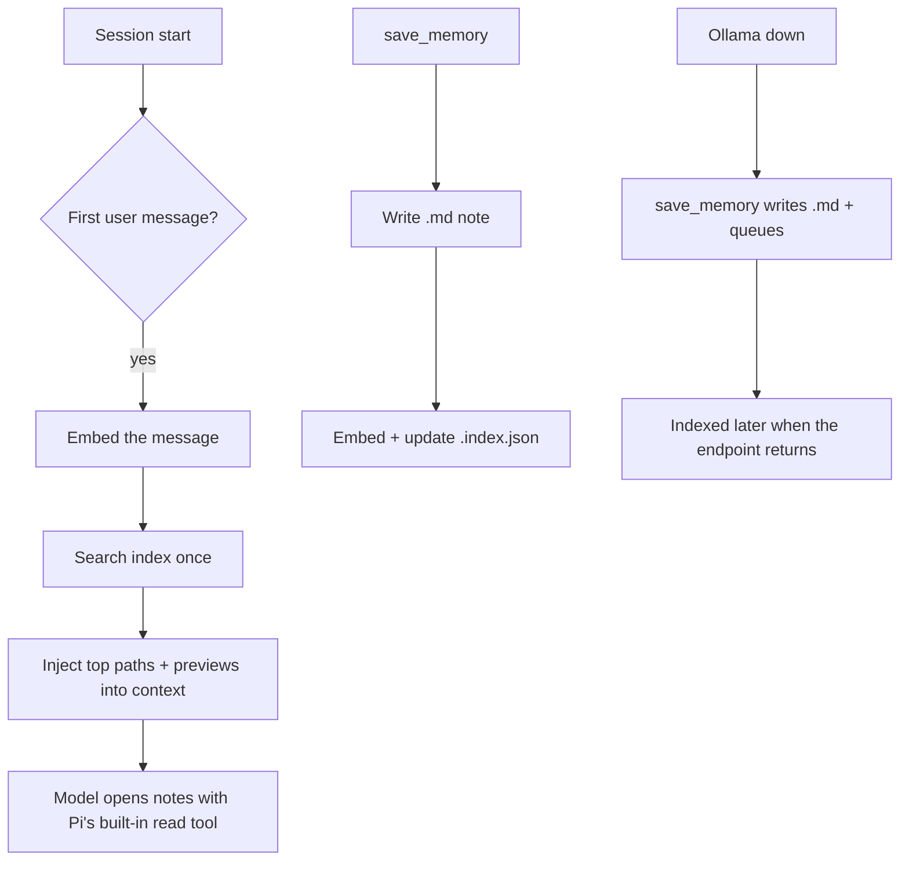
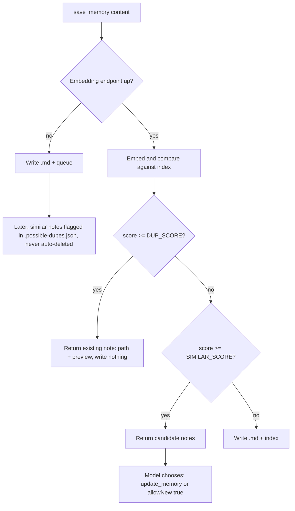

# semantic-memory

A long-term memory for the [Pi coding agent](https://pi.dev): durable Markdown
notes, embedded locally with `embeddinggemma` through Ollama, and found by
cosine similarity.

## Requirements

- [Pi](https://pi.dev) coding agent (developed and tested against v1.3.0).
- Node.js ≥ 20 to run; ≥ 22.12 to develop/test (vitest).
- [Ollama](https://ollama.com) running locally, with the embedding model:
  ```bash
  ollama pull embeddinggemma
  ```

## Install

```bash
# local path
pi install "$PWD"

# from git (replace <user>/<repo> with the actual repo)
pi install git:github.com/<user>/<repo>
```

## Configure

All configuration is via environment variables (all optional):

| Variable | Default | Meaning |
|---|---|---|
| `SEMANTIC_MEMORY_EMBED_URL` | `http://localhost:11434` | Base URL of the local embedding endpoint |
| `SEMANTIC_MEMORY_EMBED_MODEL` | `embeddinggemma` | Embedding model name |
| `SEMANTIC_MEMORY_DIR` | `~/.pi/agent/memory` | Memory storage directory |
| `SEMANTIC_MEMORY_DUP_SCORE` | `0.97` | note→note score at/above which a save is a duplicate |
| `SEMANTIC_MEMORY_SIMILAR_SCORE` | `0.59` | note→note score at/above which a save returns candidates |
| `SEMANTIC_MEMORY_MIN_SCORE` | `0.44` | query→note floor for automatic injection |

## How it works

Memory is stored as plain `.md` files with `id`/`created`/`updated`/`tags`
frontmatter. Each note is embedded and kept in an index; search returns file
paths and scores, never note contents — the model opens hits with Pi's built-in
`read` tool.

Three tools are registered:

- `save_memory(content, tags?, allowNew?)` — writes and indexes a note (with
  dedupe, see below).
- `search_memory(query, topK?, minScore?)` — returns the top matching note
  paths and scores.
- `update_memory(file_path, content, tags?)` — replaces a note's body in place,
  keeping `id`/`created`, setting `updated`, and archiving the previous version
  to `.archive/`.





## Usage

In a Pi session, the model calls the tools as needed:

```text
save_memory(content="User prefers tabs over spaces.", tags=["preference"])
search_memory(query="code formatting preference", topK=5)
update_memory(file_path="/abs/path/note.md", content="User prefers tabs, not spaces.")
```

## Security

- Reads and writes only under `~/.pi/agent/memory/` (or `SEMANTIC_MEMORY_DIR`):
  `<uuid>.md` notes, `.index.json`, `.queue.json`, `.possible-dupes.json`, and
  `.archive/`.
- Calls the local embedding endpoint (`http://localhost:11434` by default) for
  embedding text; it never sends note contents to remote services.
- Notes are plain Markdown files — treat the memory directory like any other
  user data.

## Limitations

- Thresholds are calibrated for `embeddinggemma`; a different embedding model
  needs re-calibration (`scripts/calibrate-thresholds.ts`).
- End-to-end behavior with real chat models has only been manually tested; the
  automated gate drives the tools directly.
- There is no forget/cleanup tool yet.

## Design notes

During calibration against `embeddinggemma`, a same-topic contradiction
("prefers npm" vs "prefers pnpm") scored **0.944** — higher than most reworded
duplicates (duplicate range 0.730–0.961, median 0.826) and inside the duplicate
distribution. Cosine similarity therefore cannot reliably detect a *changed*
fact. To avoid silently dropping a change, `DUP_SCORE` is set to the maximum
change/contradiction score (0.944) plus a 0.03 margin (**0.97**), and anything
below that which still looks similar (≥ **0.59**) is returned to the model as
candidates instead of being auto-deduped.

## Development

```bash
npm install
npm test              # vitest, mocked embedder
npm run lint
npx tsc --noEmit
npm run check-goal    # full integration gate (needs `pi` + Ollama)
```
